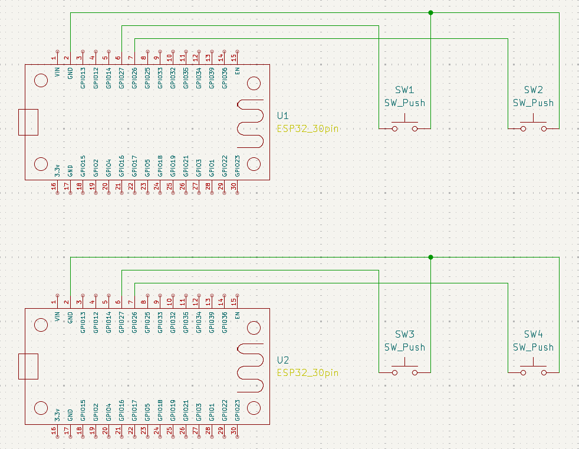

# ESP32 ESP-NOW Ping-Pong Game

Wireless two-player Ping-Pong built on two ESP32 boards and a Flutter phone app. The ESP32 boards talk to each other directly over ESP-NOW and run the whole game logic themselves, while the phone app is used only as a display. The phone connects to the host ESP32 over Wi-Fi or over BLE, so both links can be compared.

---

## Project Overview

ESP-NOW is a low-power, low-latency wireless protocol from Espressif that lets ESP32 boards exchange short packets without a router or a connection handshake. This project uses it as the link between the two players and compares Wi-Fi and BLE as the interface to a phone, to find out which one suits a real-time system better.

The full system consists of:
- **ESP32 #1 (host)** - runs the game physics, reads player 1 buttons, sends the game state to the client and to the phone
- **ESP32 #2 (client)** - reads player 2 buttons, sends its paddle position to the host
- **Mobile app** (`app/pingpong_app`) - Flutter (Android) app that displays the current game state received from the host over Wi-Fi (WebSocket) or BLE (GATT notifications)

---

## System Architecture

```
Player 1 buttons                                Player 2 buttons
  (LEFT/RIGHT)                                    (LEFT/RIGHT)
       ↓ GPIO                                          ↓ GPIO
 ESP32 #1 (host) ◄──[paddle position, ESP-NOW]── ESP32 #2 (client)
  (game physics)  ──[game state, ESP-NOW]──────►
       │
       ├──[Wi-Fi, WebSocket]──┐
       │                      ├──► Mobile app (game display)
       └──[BLE, notify]───────┘
         (host runs both, phone uses one)
```

---

## Team Responsibilities

### Bianka - hardware and firmware
- Designing the hardware schematic (ESP32 boards, buttons, wiring)
- Configuring the ESP-NOW link between the two ESP32 boards
- Writing the ESP32 firmware in C++ (Arduino framework, PlatformIO)
- Implementing the game logic and physics (ball movement, bounces, collisions, scoring)
- Implementing Wi-Fi and BLE communication with the phone on the ESP32 side

### Dawid - mobile app and testing
- Building the mobile app and the game screen
- Implementing Wi-Fi and BLE communication with the ESP32 on the phone side
- System integration
- Measuring latency and stability of the Wi-Fi and BLE links

---

## Hardware

| Component | Purpose |
|---|---|
| 2x ESP32 DevKit | Host and client |
| 2x Breadboard and ~10x jumper wires | Wiring |
| 4x push button | LEFT / RIGHT for each player |
| Phone (Android) | Game display |
| 2x USB cable (data capable) | Flashing and power |

---

## Wiring Diagram



### Buttons (identical on both boards)
| Button | ESP32 GPIO | Description |
|---|---|---|
| LEFT (one leg) | GPIO25 | Move paddle left |
| RIGHT (one leg) | GPIO26 | Move paddle right |
| Other leg of both buttons | GND | Ground |

No external resistor is needed - the firmware enables the internal pull-up (`INPUT_PULLUP`), so a pressed button reads as `LOW`. Place each button across the center gap of the breadboard, so its two sides sit in different rows: one side goes to the GPIO pin, the other to GND. Pins can be changed in `lib/protocol/config.h`.

---

## How It Works

**Game:**
1. Player presses the LEFT or RIGHT button
2. The ESP32 reads the GPIO state and moves its paddle
3. ESP32 #2 sends its paddle position to ESP32 #1 over ESP-NOW
4. ESP32 #1 runs the physics: moves the ball, detects bounces and updates the score
5. ESP32 #1 sends the current game state to ESP32 #2 over ESP-NOW (about 60 times per second)

**Phone display:**
1. ESP32 #1 forwards the current game state to the phone
2. The host runs a Wi-Fi access point (WebSocket) and BLE at the same time - the phone connects over one of them
3. The app receives the data and draws the board

**Rules:** player 1 (host) plays the bottom paddle and player 2 (client) the top one. The first player to 5 points wins. The ball speeds up on every paddle hit and the bounce angle depends on where it hits the paddle. After the game ends, pressing both host buttons at once restarts it.

---

## Communication Protocol

Packets are packed structs defined in `lib/protocol/protocol.h`. Each one carries a sequence number so packet loss can be measured on the receiving side.

### Client → Host (`InputPacket`, 9 B)
| Field | Type | Description |
|---|---|---|
| `type` | uint8 | `PKT_INPUT` |
| `seq` | uint16 | Sequence number |
| `paddle_x` | int16 | Center of the player 2 paddle |
| `t_ms` | uint32 | Sender `millis()` |

### Host → Client / Phone (`StatePacket`, 18 B)
| Field | Type | Description |
|---|---|---|
| `type` | uint8 | `PKT_STATE` |
| `seq` | uint16 | Sequence number |
| `ball_x`, `ball_y` | int16 | Ball position |
| `p1_x`, `p2_x` | int16 | Paddle centers |
| `score1`, `score2` | uint8 | Scores |
| `status` | uint8 | `0` serve, `1` playing, `2` game over |
| `host_t_ms` | uint32 | Host `millis()` |

---

## Phone Interface Modes

| Mode | Transport | Notes |
|---|---|---|
| Wi-Fi | Access point on the host + WebSocket | Full 60 Hz updates, higher throughput, but the phone has no internet access over this network |
| BLE | GATT notifications | Every 2nd packet (~30 Hz), lower power, limited packet size |

Planned measurements: end-to-end latency, jitter, packet loss, range, and the effect of running ESP-NOW in parallel.

---

## Mobile App

The app (`app/pingpong_app`) is only a display - all game physics runs on the ESP32 host. It receives `StatePacket` data over Wi-Fi (WebSocket) or BLE (GATT notifications) and draws the board.

```bash
cd app/pingpong_app
flutter pub get
flutter run          # phone connected over USB, USB debugging on
flutter build apk    # APK to install manually
```

- **Wi-Fi:** join the `PingPong` access point created by the host (WebSocket at `ws://192.168.4.1:81`), then choose Wi-Fi mode in the app
- **BLE:** choose BLE mode and connect to `PingPong` from the scan list

---

## Repository Structure

```
├── lib/
│   ├── game/
│   │   ├── game.h/.cpp      # Game physics and scoring (no Arduino dependency)
│   └── protocol/
│       ├── protocol.h       # Packet definitions
│       └── config.h         # MAC addresses, pins, channel, tick rate
├── src/
│   ├── host/
│   │   ├── main.cpp         # Host: physics, ESP-NOW, state broadcast
│   │   └── phone.h          # Hooks for the Wi-Fi / BLE link to the phone
│   └── client/
│       └── main.cpp         # Client: buttons, ESP-NOW
├── include/
├── test/
├── platformio.ini           # Two environments: host and client
├── wiringDiagram.png        # Hardware wiring diagram
│
├── app/
│   └── pingpong_app/        # Flutter mobile app (game display, Wi-Fi and BLE client)
│
└── README.md
```

---

## Setup & Flashing

**Requirements:**
- [Visual Studio Code](https://code.visualstudio.com/) with the [PlatformIO IDE](https://platformio.org/install/ide?install=vscode) extension
- USB driver for the board (CP210x or CH340)
- Platform pinned to `espressif32@6.9.0` (Arduino-ESP32 core 2.0.17) in `platformio.ini`

The host and the client are **two different programs**, so flash one board at a time.

**1. Read the MAC address of each board:**

```bash
# Board 1 -> host
pio run -e host -t upload --upload-port COM5
pio device monitor -b 115200 --port COM5     # note "HOST MAC: ..."

# Board 2 -> client
pio run -e client -t upload --upload-port COM6
pio device monitor -b 115200 --port COM6     # note "CLIENT MAC: ..."
```

Replace with your appropriate COM port.
The MAC address is printed only once at startup. If the monitor shows nothing, press the **EN** (reset) button on the board.

**2. Put both MAC addresses into `lib/protocol/config.h`** (for example `AA:BB:CC:11:22:33` becomes `0xAA, 0xBB, 0xCC, 0x11, 0x22, 0x33`):

```cpp
static const uint8_t HOST_MAC[6]   = {0xAA, 0xBB, 0xCC, 0x11, 0x22, 0x33};
static const uint8_t CLIENT_MAC[6] = {0x.., 0x.., 0x.., 0x.., 0x.., 0x..};
```

**3. Flash both boards again** with the same commands as above (`-e host` for the host board, `-e client` for the client board).

**4. Check the link:** power both boards. In the host serial log `rx=` should keep growing with `lost=` near zero, and the client log should print the ball position and the score.

If upload hangs on `Connecting...`, hold the **BOOT** button on the board while flashing starts.

---

## Tech Stack

- **Language:** C++ (Arduino framework)
- **Build system:** PlatformIO
- **Communication:** ESP-NOW (ESP32 ↔ ESP32), Wi-Fi and BLE (ESP32 ↔ phone)
- **Protocols:** GPIO (buttons)
- **Hardware:** 2x ESP32 DevKit, push buttons
- **Mobile App:** Flutter (Dart), `web_socket_channel`, `flutter_blue_plus`

---

## Known Limitations

- ESP-NOW runs on the Wi-Fi radio, so the Wi-Fi access point and ESP-NOW must use the **same channel** (`ESPNOW_CHANNEL`)
- Wi-Fi AP and BLE are both active on the host at the same time and share the radio with ESP-NOW, so extra packet loss is possible
- ESP-NOW packets are sent without encryption
- The firmware must be built with Arduino-ESP32 core 2.x (callback signatures differ in 3.x)

---

## Status

University group project - core functionality complete.
Hardware and mobile app are done - latency, stability and ESP-NOW range tests TBD.